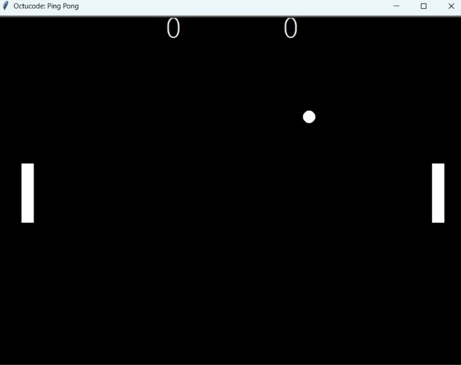

# 🏓 Ping Pong Game

Un jeu de Ping Pong à deux joueurs développé en Python avec le module `turtle`.



## Fonctionnalités

- Deux joueurs sur le même clavier
- La balle rebondit sur les murs et sur les raquettes
- La balle accélère à chaque rebond sur une raquette
- Score affiché en temps réel, la balle revient au centre après chaque point

## Commandes

| Joueur | Monter | Descendre |
|--------|--------|-----------|
| Gauche | `Z` | `S` |
| Droite | ⬆️ | ⬇️ |

## Lancer le jeu

### Option 1 : Exécutable Windows

Télécharge `ping-pong.exe` depuis la page des [Releases](https://github.com/omarzawem-design/ping-pong-game/releases) et double-clique dessus.

### Option 2 : Depuis le code source

Prérequis : Python 3 (le module `turtle` est inclus).

```bash
git clone https://github.com/omarzawem-design/ping-pong-game.git
cd ping-pong-game
python main.py
```

## Structure du projet

```
ping-pong-game/
├── main.py       # Boucle principale du jeu
├── paddle.py     # Classe Paddle (raquettes)
├── ball.py       # Classe Ball (balle)
├── score.py      # Classe Scoreboard (score)
└── README.md
```

## Auteur

**Omar Zawem**
- GitHub: [@omarzawem-design](https://github.com/omarzawem-design)
- LinkedIn: [Omar Zawem](https://linkedin.com/in/omar-zawem-40746b339)